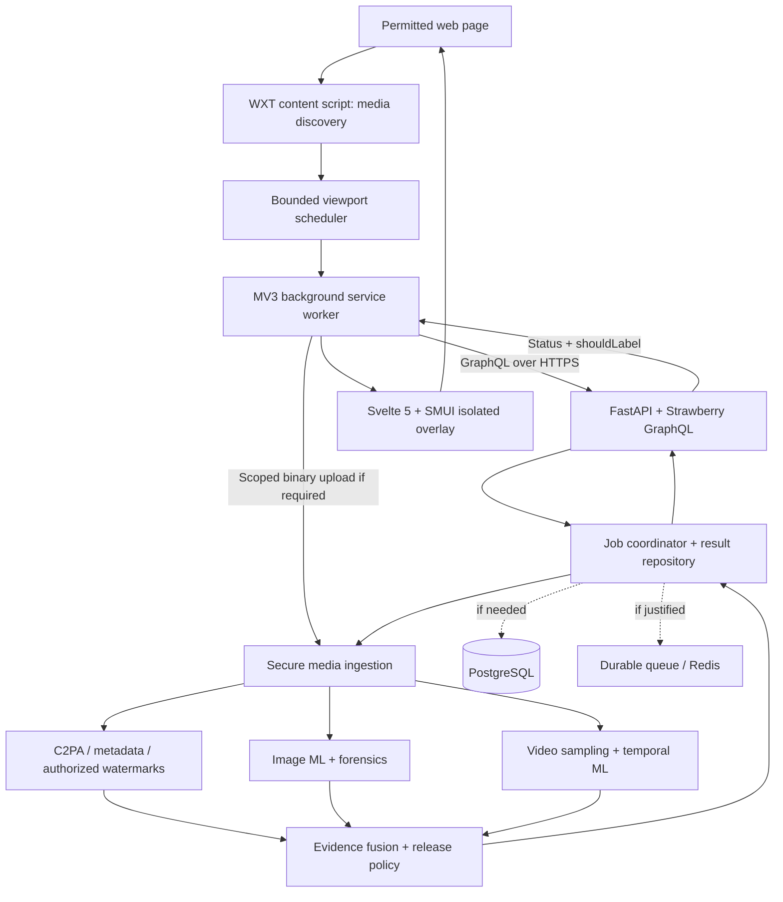
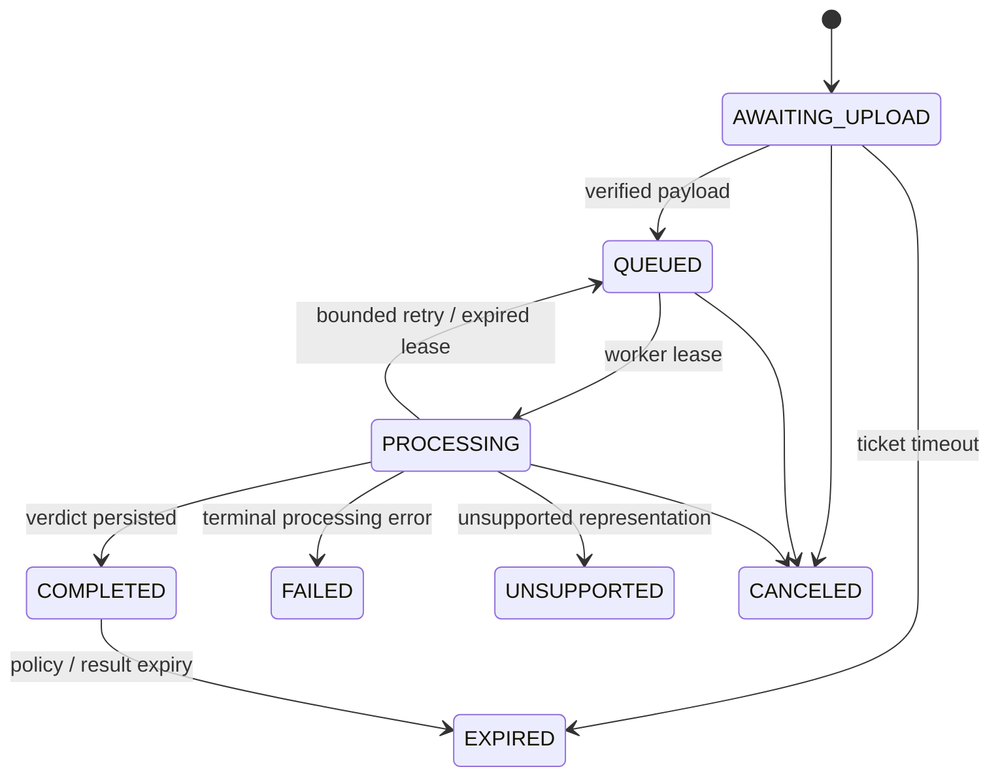

# Label.ai — Master Product & Engineering Specification

**Version:** 1.0 | **Date:** November 24, 2026 | **Status:** Proposed for owner approval  
**Audience:** OpenCode / autonomous coding agents and engineers  
**Product:** Chrome extension for identifying AI-generated visual media  
**User-facing label:** `AI Slop Detected 🤮`

This document is the product source of truth, implementation brief, acceptance-test contract, and release checklist. It is intended to be used alongside the repository's existing `AGENTS.md`, which governs engineering behavior. The owner has requested a complete application, not a prototype that merely demonstrates a label. Everything described as mandatory must be implemented and verified, or explicitly recorded as blocked. Recommendations and quantitative targets are proposed defaults for approval, not claims of achieved performance.

## 1. Instructions to the implementation agent

1. Read this entire document and all applicable `AGENTS.md` files. Inspect the existing repository, working tree, branch, dependencies, available hardware, tools, and current documentation before proposing changes. Preserve existing useful work and uncommitted user changes. Do not assume the repository is empty.
2. Start in **Plan mode**. Do not change source code, install dependencies, modify configuration, create migrations, or perform mutating actions until the owner explicitly approves the plan and authorizes Build mode. Native tool permissions and safety constraints remain in force. A plan may be written to a designated OpenCode plan file only if requested and permitted.
3. Present a dependency-ordered plan covering every requirement ID in section 23, architecture decisions, model candidates and licenses, privacy and acquisition policy, testing methodology, deployment, cost and hardware assumptions, known limits, and any genuine owner decisions. Identify any conflict with existing instructions rather than silently overriding it. Distinguish approved requirements from proposed defaults. Break work into milestones with exit criteria and agent assignments.
4. After approval, enter Build mode when the owner switches the native agent or otherwise authorizes implementation with appropriate permissions. Execute the whole approved plan autonomously. Do not ask for approval after each stage. Obtain renewed approval for material changes in scope, privacy practices, deployment cost, external services, or acceptance criteria. Never treat this document alone as approval to start building.
5. Use up to four concurrent agents total: one primary orchestrator and up to three subagents. Proactively delegate independent research, test design, implementation, and review when tools permit. During planning use read-only agents. During building assign explicit file ownership, branch/worktree strategy if useful, contracts, and test obligations. Avoid overlapping writes; do not spawn recursively or exceed the concurrency cap. The primary agent integrates and independently verifies results. If subagents are unavailable, continue sequentially and report the constraint.
6. Follow strict test-driven development (Red → Green → Refactor) for observable changes. Record the initial failure and subsequent pass where practical. For ML work, first implement evaluation contracts, data validation and negative controls; do not invent a failing statistical test merely to satisfy TDD. Test actual inference on licensed fixtures and holdout data, not just stubs. Apply SOLID, DRY, KISS, YAGNI, separation of concerns, least privilege, strong typing, idiomatic Svelte/Python, focused modules, useful comments, reproducible builds and dependency hygiene. Avoid premature abstraction and needless microservices.
7. No hardcoded verdicts, URL-based guesses, keyword-based classifications, fake detector implementations, simulated production responses, hidden mocks, silent fallbacks to random scores, fabricated benchmarks, or placeholders counted as done. Test doubles may be used for isolated tests only and must never be selected by production configuration. All substantive paths must have real integration and acceptance evidence.
8. Maintain durable progress in `docs/IMPLEMENTATION_PLAN.md`, `docs/REQUIREMENTS_TRACEABILITY.md`, `docs/DECISIONS.md`, `docs/PROGRESS.md` and `docs/RELEASE_GATES.md` (or existing equivalent paths, documented). Include approved scope, requirement IDs, test paths, commands, evidence, owners, actual status, blockers, and next work. Resume from these records after model switches, compaction, or session interruption; never reinitialize or discard prior work. Keep project `AGENTS.md` concise; point to this specification instead of duplicating it.
9. Continue until all authorized work that can be performed without the owner is complete. Fix regressions and failed tests; do not stop at a passing subset. Do not deploy publicly, publish to a store, purchase services, expose secrets, or push to a protected/shared branch without authorization. Never invent credentials or circumvent access restrictions.
10. Report implementation completion separately from experimental model performance, operational readiness and public release readiness. A successful build, high test coverage, or many passing tests is not proof of complete functionality or reliable media classification.

Suggested initial agent prompt (use in Plan mode):

> Read the entire root AGENTS.md and LABEL_AI_SPECIFICATION.md. Treat the latter as the full product requirements and acceptance-test contract for Label.ai. Inspect the repository and research any version-sensitive or unresolved technical choices. Use read-only subagents when beneficial. Produce a comprehensive, dependency-ordered implementation plan mapped to every requirement ID, including concrete tests, model benchmarking, security, privacy, and release gates. Do not modify code or start Build mode until I explicitly approve the plan. After approval, implement all approved stages autonomously and continue until all independently executable work is complete. Report actual test and benchmark evidence, unresolved requirements, and genuine blockers separately.

## 2. Product definition and scope

### 2.1 Vision

Label.ai is an unobtrusive, automatic visual-media identification layer for browsing. It discovers accessible images and videos across permitted websites, analyzes their origins and visual signals, and overlays a single noticeable label when there is sufficiently strong evidence that the content is substantially AI-generated. The extension must not censor, hide, replace, downrank, or interfere with the media. No user action is required during ordinary browsing after informed setup and permission grants.

### 2.2 Explicit owner requirements

- Name the product **Label.ai**.
- Target Chrome / Chromium-compatible Manifest V3; Chrome is the required initial browser.
- Use WXT, Svelte 5, TypeScript, and Svelte Material UI (SMUI) for the extension. Use Material Design styling, including for the label.
- Use FastAPI/Python backend services for detection; frontend/backend application communication must use GraphQL and a GraphQL client. Binary upload may use a dedicated authenticated HTTP transfer endpoint as a transport exception, not REST for ordinary application operations.
- Use PostgreSQL if persistence is necessary; prefer it over introducing another relational database. Additional infrastructure must have a demonstrated purpose.
- Detect both AI-generated images and AI-generated videos. Use current evidence-based techniques, including provenance, watermarks, image classifiers and video-specific analysis. The backend owns all classification, confidence, evidence, and final labeling decisions.
- The only normal browsing UI is the label `AI Slop Detected 🤮` (capitalization follows the revised mockup). It must have an eye-catching, short animation. No tooltip, confidence score, dashboard, popup, button, explanation, spinner, or authenticity badge. Do not display labels on negative, pending, failed, unsupported or inconclusive media.
- Follow the existing AGENTS.md practices: planning first, owner approval before Build, TDD, best practices, proactive subagents, complete requirement traceability and final acceptance verification.

### 2.3 Proposed scope defaults to confirm in Plan mode

- Label origin, not artistic quality, political truth, factual accuracy, or a person's identity. The requested phrase is product copy, not a technical classification of quality. Do not train a subjective "slop" score.
- Positive scope: fully or substantially generated visual media, including photorealistic and stylized generation. Distinguish minor AI edits, conventional editing, face manipulation and uncertain composites internally. Default to **no label** for merely AI-assisted edits, face swaps alone, CGI of unknown origin, or videos with isolated AI segments unless reliable evidence and an approved materiality policy justify the label. Require independent evaluation of mixed/edited content; default to abstention when scope cannot be established. Do not broaden scope silently.
- No text or audio-origin detection, user accounts, payments, social features, content moderation, dashboards, or mobile app in v1. Audio tracks need not be uploaded or analyzed separately. Raw media retention is disabled by default; approved temporary processing only.
- Target public, accessible, permission-granted visual media, not all content everywhere. Authenticated/private pages, local files, intranets, protected streams and restricted Chrome pages are excluded by default. A normal browsing page can contain private content even on a public domain; treat ambiguity conservatively.
- Minimal mandatory consent/permission/privacy setup is a narrow exception to label-only browsing UI. It must not become a dashboard. Respect browser-managed controls and immediate opt-out. Do not transmit before informed consent and applicable host grants.

### 2.4 Definition of success

A supported generated media item that has been positively classified by the approved backend policy shows exactly one label, on the correct visible item, without user initiation. Other items have no added visible UI. The product works on a representative range of real websites, fails closed, and has independently measured detection quality. Never claim universal detection or that unlabeled content is genuine. Protected or inaccessible media and new generators will necessarily leave some content unclassified.

## 3. Research and technical strategy

Research reviewed November 24, 2026; references in section 25. Revalidate provider access, API terms, model checkpoints, licenses, compatibility and costs in Plan mode. Do not assume current documentation implies available credentials or commercially usable weights.

| Technique | Proposed implementation | Reliability and limitations |
|---|---|---|
| Cryptographic provenance | C2PA / Content Credentials via official Python SDK, trust policy, asset binding and signed action inspection | Strong when the trusted signed assertion actually establishes in-scope generation and applies to the analyzed asset. Missing credentials are not a negative verdict; valid signatures do not establish factual truth. |
| Invisible watermarks | Provider-supported detection, e.g. SynthID or authorized OpenAI provenance API for supported content | Coverage is provider- and format-specific. A hit can indicate AI editing rather than substantial generation; negative/missing results do not exclude AI. Access and licensing must be checked. |
| Metadata | EXIF/XMP/IPTC generation fields, software and processing indicators | Unsigned, easily altered or stripped. Never sufficient by itself. |
| Image classifiers | Benchmark CLIP/vision-language feature models, DINO-style features, specialist CNN/ViT detectors and reconstruction-based candidates | Learn visual signals but often fail on unseen generators or distribution shifts. Calibration and holdout tests are compulsory. |
| Image forensics | Evaluate frequency/noise/residual, compression, patch-level and reconstruction features | Secondary evidence only unless independently validated; authentic media processing can produce similar artifacts. |
| Video detectors | Adaptive frame sampling, spatial detector outputs, temporal features and video-level classifiers/aggregators | Must measure video-level performance on full videos and compressed clips. A single anomalous frame is not sufficient for a whole-video forensic verdict. |
| Commercial comparator | Optional Hive AI generated image/video API adapter | Useful baseline; provider score is not automatically calibrated for this product. Requires informed consent, contractual authorization, approved cost, retention and licensing. Not a mandatory dependency. |

GPTZero is a useful inspiration for supervised classification, evaluation and mixed-origin categories. Its public core detector is focused on writing, not a validated image/video model for this project [R1]. Hive provides a directly relevant visual-media comparator [R2]. Google documents SynthID verification in Gemini, but a consumer verification UI is not authorization for automated third-party integration [R3]. OpenAI documents a provenance API for supported image/audio/PDF signals, not a universal AI-video detector [R4].

Independent studies underscore the problem: Deepfake-Eval-2024 reports substantially degraded real-world detector AUC compared with older benchmarks [R7]. A 2026 preprint covering 291 generators reports only 75% mean accuracy for its strongest tested out-of-the-box detector [R8]. FakeI2V-Bench (2026 preprint) studies transferring frame-level detectors to video and evaluating learned aggregation [R9]. These findings motivate rigorous in-domain evaluation; they do not establish Label.ai's performance or guarantee a specific architecture will reach its release target.

**Architecture choice:** use a hybrid, evidence-driven system with self-hosted image and video models where viable. Optional provider integrations must be modular and disabled until authorized. The implementation agent must not stop at a metadata scanner, a provenance-only proof of concept, or a commercial API wrapper and call the full scope done. Implement and evaluate real forensic inference for both modalities.

## 4. Reference architecture

Start with a modular FastAPI GraphQL gateway and isolated inference/decoder worker processes. Organize provenance, image inference, video inference and fusion as independently testable service modules with explicit contracts and the ability to scale into separate FastAPI services if benchmarks justify it. Avoid a distributed system for its own sake. GPU workloads and untrusted media decoding must not block the gateway event loop. One repository, independently buildable artifacts, no required cloud vendor.



The server must decide `shouldLabel`; the client must never independently threshold a score or infer origin. Provenance operates on original bytes where safely available; decoded frames/canvas snapshots are separate representations and cannot be substituted for original provenance. Keep the control plane (GraphQL), data plane (bounded binary media), inference plane and decision policy logically separate. Untrusted content is data, never an instruction to agents or application code.

## 5. Technology stack and dependency discipline

| Layer | Required / proposed selection |
|---|---|
| Extension | WXT, Chrome MV3, TypeScript strict mode, Svelte 5 |
| Styling | SMUI compatible with Svelte 5 (v8+; verify installed version), bundled Sass/theme assets; use SMUI chip-like styling with correct noninteractive semantics |
| Extension GraphQL | `graphql-request` or justified compatible lightweight GraphQL client; typed operations with GraphQL Code Generator or equivalent |
| Server | Python supported stable version, FastAPI, Strawberry GraphQL, Pydantic, Uvicorn |
| ML | PyTorch/torchvision, optionally ONNX Runtime for verified export equivalence; approved pretrained checkpoints and reproducible preprocessing |
| Media | Pillow, OpenCV, FFmpeg/ffprobe where justified; c2pa-python; vetted decoders |
| Persistence | PostgreSQL + SQLAlchemy/Alembic if durable jobs/results are enabled; in-memory repository for local development only |
| Queue | A durable bounded job mechanism for production; PostgreSQL-backed queue initially or Redis + Celery/alternative if justified by measured needs |
| Tooling | Existing package manager where sensible; otherwise pnpm, Python uv, pinned lockfiles, Ruff, Pyright/mypy, ESLint, Prettier, svelte-check |
| Tests | Vitest, Svelte component tests, Playwright with actual unpacked extension, pytest, Hypothesis where valuable, real GraphQL integration, model benchmark harness |
| Delivery | Docker/Compose, GitHub Actions or existing CI, reproducible build scripts, model manifests, SBOM/license checks |

Select compatible stable versions; pin exact resolved dependencies and model weights, don't paste stale version numbers or switch established tooling unnecessarily. SMUI officially supports Svelte 5 beginning with v8 [R11]; it is a Material component library, not a guarantee of native Material 3 compliance. WXT supports Svelte mounting in isolated UI [R10]. Strawberry provides FastAPI integration [R12]. Do not add SvelteKit, React, a full UI suite, an LLM call or vector database merely because it is familiar. No remotely executed extension code, dynamically fetched executable models/scripts in the extension, or CDN-hosted UI assets.

## 6. Repository layout (adapt to existing repository)

```text
Label.ai/
  AGENTS.md
  LABEL_AI_SPECIFICATION.md
  README.md
  .env.example
  .gitignore
  apps/
    extension/
      entrypoints/
        background.ts
        media.content/index.ts
        consent/                  # setup only, if necessary
      src/
        discovery/                # DOM discovery, lifecycle, site adapters
        media/                    # safe acquisition descriptors
        scheduling/               # visibility, budget, dedup
        transport/                # typed messages, GraphQL client
        components/SlopLabel.svelte
        components/OverlayRoot.svelte
        styles/label.scss
        state/
      tests/
      wxt.config.ts
    backend/
      label_ai/
        api/                      # Strawberry schemas, resolvers
        domain/                   # types, policies, ports
        ingestion/                # bounded fetch/upload, decode
        detection/
          provenance/
          metadata/
          watermarks/
          image/
          video/
          fusion/
        jobs/
        persistence/
        security/
        observability/
      migrations/                 # only if DB enabled
      tests/
      pyproject.toml
  packages/contracts/             # schema, generated types, protocol fixtures
  ml/
    configs/                      # reproducible experiment configuration
    registry/                     # approved checkpoint manifests, hashes, licenses
    datasets/                     # manifests and fetch scripts, not bulk media
    evaluation/                   # calibration, holdouts, reporting
    tests/
  tests/e2e/                      # local media-site harness + real backend
  tests/fixtures/                 # small licensed/synthetic fixtures
  infra/                         # containers, Compose, deployment templates
  docs/                          # ADRs, test traceability, runbooks, privacy
  scripts/
  .github/workflows/
```

Maintain clear dependency direction: API → application/domain ports → implementations. The detection domain must not import web-framework or persistence details. No circular service dependencies. Generate frontend contract types from the checked schema; fail CI when generated output is stale. Never commit secrets, private media, large weights, benchmark datasets without rights, or build artifacts by accident.

## 7. Extension media discovery and lifecycle

### 7.1 Generic discovery

Discover rendered `img` elements (`currentSrc` rather than stale `src`, including `picture`/`srcset`), HTML5 `video` (`currentSrc`, `<source>`, load events), and eligible CSS `background-image` URL layers on visible elements. Cover linked or dynamically inserted media, responsive source changes, lazy loading, infinite feeds and SPA navigation. Treat video posters as separate visual assets; a positive poster must not imply the video itself is AI-generated. Prefer displaying the video label only on a positive video verdict, not a stale poster verdict after playback.

Maintain a registry per document/frame with an opaque instance ID, source-generation counter, asset identity/representation, media kind, bounding rect and job mapping. Use `MutationObserver` for relevant DOM changes; `IntersectionObserver` for visibility and viewport priority; `ResizeObserver` and scoped scroll/resize handling for overlay geometry. Subscribe to media load/error events and `loadedmetadata` / `emptied` / source changes; handle SPA route changes, page visibility, pagehide and document invalidation. Observe open shadow roots when accessible; handle frames only with valid site grants. Do not instrument closed shadow roots, override page APIs, or use continuous whole-document scans. Debounce mutation bursts, ignore own shadow hosts, use bounded incremental traversal, clean up all observers/listeners, and avoid duplicate registrations.

### 7.2 Source identity and representation

- Maintain identity separately for DOM instance, source version, content digest and representation type. URLs are not immutable identity, and identical URLs across users or time may serve different bytes. Use strong content hashes when bytes are available; use request-scoped tokens and representation/version tracking until hashing. Do not label a new item with an old response.
- The approved full-quality direct image/video source is preferred. Record any resize, screenshot-like crop, canvas frame or sampled segment and its limitations. Never assert byte-level provenance for a transcoded/captured copy of a different source.
- CSS multiple layers, sprite sheets, avatars, tiny icons, partially occluded content, transparent pixels and clipping need conservative handling. Proposed first-pass minimum eligible area: 128×128 visible CSS pixels for images and 160×90 for video; tune through benchmark and product review. Do not silently advertise detection of skipped content. Configurable limits must have tests and document tradeoffs. Tiny media may still be eligible if a separately validated low-resolution strategy exists.
- Exclude native browser UI, browser stores/restricted schemes, extension pages, file URLs, password/checkout/banking/private-message pages, local/intranet sources, incognito by default, and other known sensitive or ambiguous contexts. Site adapters may restrict further, never weaken privacy gates.

### 7.3 Platform adapters

Generic engine first; targeted adapters only for proven lifecycle/layout issues. Priority public-page compatibility: X, Instagram, Facebook, Reddit, TikTok, YouTube, LinkedIn and representative news/publisher sites. Adapters implement a narrow interface (discover candidates, identify safe public context, resolve permitted source, anchor label, lifecycle cleanup), with generic fallback. Do not rely on a single brittle selector or undocumented authenticated endpoints; never automate login, bypass paywalls/DRM/access restrictions, or intercept cookies. Local fixtures reproduce site patterns; live checks are separate and must record actual URLs, date, browser version and observed support without storing browsing history in production. Support on any named platform is unverified until tested; if public media is inaccessible, abstain and document.

### 7.4 Scheduling and MV3 messaging

Use a visibility-prioritized, bounded queue. Starting defaults: max 4 in-flight analyses per tab, max 8 per extension, max 1 video per tab, queue cap 50 per tab, deduplicated same-content work where permitted; configurable and load-tested. Pause starting jobs on hidden tabs; cancel obsolete subscriptions when media leaves the page or changes (allow a short grace for fast scrolling); use refcounts for shared work. Add retry/backoff with jitter and ceilings; honor rate-limit signals, do not retry unsupported input indefinitely. Do not block page load, scrolling, links, or playback.

Use typed runtime messages only between extension-owned contexts; validate sender, document/tab/frame association, schema, sizes, and request IDs. No generic privileged `fetch(url)` RPC exposed to arbitrary page scripts. Content scripts never hold server secrets. Background service worker sends GraphQL to configured backend origin, with deadlines and request correlation. Chrome may terminate idle workers [R13]; persist only minimal opaque job IDs, consent state, bounded local cache or retry state as necessary, not media URLs or bytes. Reconcile jobs on wake and revalidate source generation before applying any result. Use asynchronous short calls and bounded polling with backoff; no artificial keep-alive loops. For page messages use subscriptions/ports where appropriate but support disconnect and re-establish. Cross-origin extension requests obey host permissions and must follow approved acquisition policy [R14].

## 8. Label UI and animation — final visual requirement

Render exactly **AI Slop Detected 🤮**. This replaces the original `AI-generated` wording. Use a compact, noninteractive Material-style pill, with the vomiting-face emoji trailing the text. Implement as a Svelte component using SMUI theme/typography/elevation (or a correctly noninteractive SMUI chip if the chosen version supports static semantics). Do not create a fake button or focusable chip solely for styling. All CSS and fonts must be packaged with the extension; prefer a local font stack, no external Google Fonts request.

### 8.1 Visual specification (proposed tokens)

| Attribute | Value |
|---|---|
| Text | `AI Slop Detected 🤮` (exact visible copy) |
| Position | Upper-left of visible media rectangle, 8px inset; keep within clipped bounds |
| Shape | Fully rounded pill, radius 999px |
| Height | Target 30–32 CSS px; compact 24px variant on smaller eligible media |
| Padding | 10–12px horizontal, 5–6px vertical; compact 6–8px horizontal |
| Typography | Roboto if packaged, otherwise system sans-serif; 13px/16px, weight 600; compact 11px |
| Rest color | Charcoal `#212121` or `#242424`, opaque/high contrast |
| Text | `#FFFFFF`; emoji standard system rendering, decorative for assistive technology |
| Alert color | Dark Material-style red `#B71C1C`; short red glow, no white flash |
| Elevation | Modest shadow, e.g. 0 2px 6px rgba(0,0,0,.25) |
| Behavior | Pointer-events none, no focus, no click, no hover affordance, no tooltip, no ripple |

Use a WXT-created Shadow DOM UI (`createShadowRootUi`, appropriate CSS injection mode, Svelte 5 `mount`/`unmount`) with isolated theme and pixel-based sizing; the host site's rem/font/animation styles must not alter it. Prefer one isolated overlay root per document/frame with keyed labels over mounting thousands of independent apps. Position based on the actual visible media rect; handle clipping, overflow, transforms, object-fit, responsive sizing, scrolling, zoom, fullscreen when supported, z-index and native controls. Do not rearrange the page or wrap/replace media in ways that alter layout. Hide overlays that cannot be safely placed; do not cover controls. Remove labels on element/source change, disconnection, revoked consent/permissions, expiration/invalidation or negative replacement result. At most one label per positive media instance, even when multiple detectors report it.

### 8.2 Attention animation

The label appears only after a completed, approved positive result. Proposed choreography: a 180ms pop/fade from scale .88 to 1.04; a short red accent pulse and subtle glow; then return to scale 1 and charcoal by 720ms. Run once per newly positive source instance, not continuously and not every scroll/render/poll. No rapid flashing, shaking, audio, haptics, or full-screen effects. Honor `prefers-reduced-motion: reduce` with an immediate static label. Limit simultaneous animation starts on dense feeds to reduce distraction. The GIF mockup illustrates the transient charcoal → red → charcoal design; a real implementation uses CSS/Svelte, not an embedded animated screenshot or looping GIF.

Illustrative animation contract (adapt to the SMUI theme; not a substitute for a tested component):

```css
.label {
  pointer-events: none;
  border-radius: 999px;
  color: #fff;
  background: #212121;
  font: 600 13px/16px Roboto, system-ui, sans-serif;
  padding: 7px 12px;
  white-space: nowrap;
  box-shadow: 0 2px 6px rgb(0 0 0 / 25%);
  transform-origin: top left;
}
.label--new { animation: label-arrival 720ms cubic-bezier(.2,.75,.25,1) 1 both; }
@keyframes label-arrival {
  0% { opacity: 0; transform: scale(.88); }
  25% { opacity: 1; transform: scale(1.04); background: #B71C1C;
        box-shadow: 0 0 10px rgb(183 28 28 / 55%); }
  55% { transform: scale(1); background: #B71C1C; }
  100% { opacity: 1; transform: scale(1); background: #212121;
         box-shadow: 0 2px 6px rgb(0 0 0 / 25%); }
}
@media (prefers-reduced-motion: reduce) {
  .label--new { animation: none; }
}
```

Accessibility: text must meet at least WCAG AA 4.5:1 contrast throughout the visible animation states; use accessible text `AI Slop Detected` and mark the emoji as decorative when separate. Do not assign button semantics or tab stop; avoid noisy global live regions or repeated announcements while scrolling. Verify screen reader access and reduced motion. A static label is still visible when animation is suppressed. No additional classification UI, including on hover, failure, loading or unsupported media. Extension icon, install consent and privacy controls are not classification UI.

## 9. Media acquisition and privacy boundaries

Media discovery does not authorize uploading arbitrary page contents. Implement a fail-closed admission policy before any data leaves the device. Require consent, a permitted site and media origin, public-context eligibility, supported media representation, size and budget checks. Grant only necessary host access. By default no uploads from authenticated/private or uncertain contexts; cannot reliably infer public status from a domain or absence of cookies alone. Define an explicit, audited public-context policy with site adapters, exclusions and safe defaults; unknown pages remain skipped until approved safe. Public media retrieval must omit cookies, authorization headers, referrers, credentials and signed/private URL parameters. Never send the page URL, title, surrounding text, user ID, cookies, private tokens, session identifiers, or browsing history to the API. A media URL can itself expose personal information or secrets; do not log it and avoid transmitting it unless strictly necessary, safe and consented.

Acquisition paths (select the first policy-permitted representation):

1. Public, bounded original bytes accessible by permitted credential-free fetch. Prefer extension-side acquisition followed by scoped upload for privacy and binding; server-side fetching is optional and subject to the SSRF controls in section 17. Validate media URLs, origin permissions, redirects, MIME and actual bytes. Do not automatically refetch inaccessible authenticated assets.
2. Accessible video source that can be downloaded within byte/time/duration limits, decoded safely, and analyzed. Where supported, use credential-free approved public HLS/DASH source with safe bounded segment handling (no DRM, no credential propagation), or defer to future support if not implemented in v1 and explicitly approved as unsupported. Do not use a master playlist URL as proof of content.
3. Only if explicitly approved for privacy and compatible with origin restrictions: sample accessible, unprotected rendered video frames using browser media APIs without changing current playback position or recording unrelated content. Mark `FRAME_SEQUENCE` and timestamp/coverage; cannot establish original-file C2PA; use a separate validated sampled-frame policy. Do not capture entire tabs/screens or bypass tainted canvas restrictions. `blob:`/MSE, cross-origin, canvas and encrypted media often cannot be safely acquired; abstain when inaccessible. Never use debugger, screen capture, broad webRequest interception, or credential replay as a workaround.

Choose explicit production limits. Initial proposed configuration: images up to 15 MiB and 40 megapixels; videos up to 100 MiB / 5 minutes for complete-file processing; bounded streaming reads, decode wall time, frame count and total pixels; longer content may use approved, separately validated bounded sampling with coverage requirements, otherwise unsupported. Support JPEG, PNG, WebP, common AVIF where decoder supports it; GIF/animated WebP require animation-aware handling; MP4 and WebM initially (MOV only if supported/tested). Unknown, malformed, SVG with external resources, encrypted, unsupported or excessively large media must be rejected safely. No executable file parsing or user-provided codec flags.

Do not upload media that cannot be reliably associated with the correct DOM generation. Verify integrity and representation at server ingress; if a source changes or the rendered representation cannot be confirmed, leave unlabeled. Bound queue bytes in memory, release object URLs/buffers, and discard temporary files on success, failure and cancellation. Document all retention and processor terms.

## 10. GraphQL API and extension contract

### 10.1 Public operations

Use Strawberry GraphQL mounted at `/graphql` in FastAPI. Use authenticated, version-compatible, typed operations. Keep inference asynchronous: return a job ID promptly and retrieve results through bounded polling or a justified subscription mechanism. Never hold a GraphQL request open for an entire video inference. The following schema is a normative starting contract; refine in the approved plan without weakening semantics.

```graphql
scalar DateTime

enum MediaKind { IMAGE VIDEO }
enum Representation { ORIGINAL_FILE FRAME_SEQUENCE }
enum AnalysisStatus {
  AWAITING_UPLOAD QUEUED PROCESSING COMPLETED FAILED UNSUPPORTED CANCELED EXPIRED
}

type UploadTicket {
  url: String!
  expiresAt: DateTime!
  maxBytes: Int!
  method: String!
}

input MediaAnalysisInput {
  requestId: ID!
  kind: MediaKind!
  representation: Representation!
  byteLength: Int!
  sha256: String!
  declaredMime: String!
}

type MediaAnalysis {
  id: ID!
  requestId: ID!
  status: AnalysisStatus!
  shouldLabel: Boolean!
  policyVersion: String!
  expiresAt: DateTime
}

type AnalysisSubmission {
  analysis: MediaAnalysis!
  upload: UploadTicket
}

type Query {
  mediaAnalysis(id: ID!): MediaAnalysis
  mediaAnalysisBatch(ids: [ID!]!): [MediaAnalysis!]!
}

type Mutation {
  submitMediaAnalysis(input: MediaAnalysisInput!): AnalysisSubmission!
  submitMediaBatch(inputs: [MediaAnalysisInput!]!): [AnalysisSubmission!]!
  cancelMediaAnalysis(id: ID!): MediaAnalysis!
}
```

A submission is idempotent within its authorized installation/session scope. A duplicate request ID with different input is rejected. An upload ticket is a short-lived, single-job scoped capability to send bounded bytes over HTTPS. Verify the actual server-computed digest, byte length, representation and type against the submitted descriptor. Do not trust a client-declared hash as proof of content for a cached positive; verify bytes before applying a verdict across installations. Ticket URLs and tokens must never be logged. For a frame sequence, define a bounded, authenticated, versioned manifest with timestamps, image dimensions, coverage metadata and frame digests; validate every item. Do not allow generic arbitrary archive extraction. The client must not receive confidence, forensic evidence, generator identity, or model-specific scores through the public GraphQL schema.

State invariants: `shouldLabel` is true only if status is COMPLETED, the active decision policy authorizes that representation, and the verdict is not expired or revoked. The extension must also verify request ID, local source generation, consent and expiry. Unknown enum, malformed response, HTTP/GraphQL error or schema mismatch fails closed. Submit/batch supports partial errors without misassigning results. Set an explicit max batch size (initially 10), query depth/cost/alias/size limits, and deadlines. Reject arbitrary query complexity and cross-installation access. GraphQL IDE/introspection may be enabled in development only and restricted in production. Use typed application errors such as INVALID_MEDIA, LIMIT_EXCEEDED, CONSENT_REQUIRED, UNAVAILABLE, UNSUPPORTED_FORMAT and RATE_LIMITED; do not leak internal exceptions or media details.

### 10.2 Authentication and transport

No mandatory user account in v1. Propose an installation-scoped anonymous authorization flow with revocable, short-lived tokens and server-side quotas, or an equivalent abuse-resistant design. A static extension API key is public, not a secret; do not rely on it, CORS, origin headers or extension ID alone as authentication. Store tokens using appropriate extension storage with minimal exposure; do not pass to web pages or third-party services. Authorize every job read, batch read, upload and cancel. Implement bounded enrollment/rate limits, rotation, expiry and revocation, and document anonymous-abuse limitations. Only the configured HTTPS backend host is accepted for GraphQL and allowlisted upload hosts; development localhost is explicit and separate. Disable credentialed wildcard CORS; allow only required extension/development origins. A deployment may use approved API gateway controls but must not silently introduce tracking or fingerprinting.

### 10.3 Job state machine and semantics



Persist atomic transitions for production; prevent stale worker writes after cancellation or lease loss. If multiple consumers share underlying content work, cancellation removes a consumer's subscription, not another consumer's result. Recover abandoned jobs, delete orphaned uploads, retry only transient errors within a configured attempt/deadline limit, and never present a pending job as complete. Polling must stop on terminal status, timeout, navigation or revoked consent. Preserve separate job IDs and asset identity even if underlying computation is deduplicated.

## 11. Backend ingestion and processing

1. Validate authorization, declared limits, quotas, consent assertions and request schema; issue bounded upload tickets.
2. Stream input into short-lived restricted temporary storage; check size incrementally, digest, content signature, container format, type, dimensions, duration, frame/track counts and decode capability. Never rely solely on extension or MIME headers. Reject corrupt data and decompression bombs. Keep originals available only until provenance checks and processing finish. Strip audio/unneeded tracks for video inference when technically possible without losing provenance input; do not persist them or send to optional providers unless explicitly required and authorized.
3. Use isolated decoder subprocess/container with nonroot user, no arbitrary network, low privileges, CPU/memory/process/time/file quotas, read-only base filesystem and scratch directory. Invoke binaries with structured argument lists, no shell interpolation, and no user-controlled paths or protocol arguments. FFmpeg protocol/demuxer allowlists and media-resource limits are mandatory. Treat embedded URLs, manifests, subtitle/attachment content and external resource references as untrusted. Do not execute them.
4. Extract provenance from the verified original before conversion. Produce standardized image representations or bounded timestamped frames with explicit preprocessing version, orientation, color space, dimensions and coverage. Retain native original only temporarily where needed; ensure transformed pixels map to the same validated asset.
5. Run applicable detectors with deadlines, circuit breakers, structured evidence and model readiness checks. Separate CPU/GPU workloads from API event loop. Reuse loaded models; batch when safe and beneficial. Resource exhaustion yields no label, not a lower arbitrary threshold.
6. Apply calibrated fusion and versioned decision policy. Persist only privacy-approved result metadata, audit/version information and job state. Return minimal GraphQL state. Cleanup all raw media, extracted frames, temporary files and intermediate embeddings according to retention policy, including process crash recovery.

## 12. Provenance, watermark and metadata engines

### 12.1 C2PA

Use the official c2pa-python SDK and supported C2PA specification [R5, R6]. Verify active manifest, cryptographic signature, content hash/binding, certificate chain, trusted issuer, timestamp/trust settings where applicable, ingredient relationships and action history. Use a curated, versioned trust configuration; distinguish valid/trusted, valid/untrusted, invalid, missing and indeterminate. A signed capture/edit assertion is not a blanket authenticity guarantee. Recognize appropriate IPTC digital source types (e.g. trainedAlgorithmicMedia) and actions establishing substantial generation; inspect whether the assertion covers the active final asset rather than only an ingredient. For signed AI-edit assertions, apply scope policy; do not equate any AI tool use with whole-asset generation. Treat conflicting signed provenance and classifier evidence conservatively; escalate internally or abstain under approved policy.

Never turn off SDK trust verification to make tests pass. Restrict or disable remote manifest retrieval, certificate-network lookups and external assertions by default until a hardened, allowlisted mechanism exists. Never fetch URLs embedded in untrusted credentials unrestricted. Test valid trusted generated fixture, conventional capture fixture, signed AI edit, missing manifest, untrusted issuer, tampered bytes/manifest, malformed data and network failure. Generate/sign test fixtures with a test-only root that cannot be trusted in production. Document production trust-list maintenance and revocation procedure.

### 12.2 Watermarks

Define adapter interface for provider, supported formats, detection status, scope, provider response version, evidence details and errors. Use only legitimate documented APIs/SDKs with verified access, authorization, privacy terms, and approved costs. Google SynthID coverage is provider-specific; do not scrape Gemini or pretend to have unrestricted verification access [R3]. OpenAI's documented content provenance endpoint supports limited OpenAI signals and formats [R4]. If credentials or suitable APIs are unavailable, disable the corresponding adapter, report the genuine external blocker, and continue implementing the self-hosted pipeline. No fake-positive adapter. Provider evidence must identify what a positive means (generation vs editing, asset vs segment), and absence does not imply authenticity. Include rate-limit, timeout, malformed response, disabled and credential-revoked tests. A real opt-in integration test is required before enabling each provider in production.

### 12.3 Metadata

Parse bounded EXIF/XMP/IPTC and relevant container metadata without evaluating arbitrary embedded code. Normalize generator/software/digital source fields and record provenance of each signal. Metadata is mutable and may be absent, copied or spoofed; unsigned tags, file names, alt text, URL domains, captions and generator keywords alone must never create a positive result. Do not treat image aesthetics or unusual anatomy alone as proof. Do not send metadata details to the client; discard unrelated GPS, device serials, identity fields and private textual metadata. Log only sanitized evidence categories.

## 13. Image detection engine

### 13.1 Model selection and implementation

Select at least two meaningfully distinct visual detector candidates during research where viable: a foundation-model feature classifier (e.g. CLIP-based UniversalFakeDetect baseline [R16], or justified DINO/ViT alternative) and a specialized detector using different visual signals (e.g. CNN, residual/frequency/reconstruction/patch approach). Compare against each other and an optional commercial baseline. GenImage offers cross-generator and degraded-image evaluation tasks [R17]. A candidate is not approved just because it is popular or has a high published AUROC. Inspect code/checkpoint provenance and licenses; do not use unsafe serialized model artifacts or unreviewed remote code. Prefer safetensors or otherwise verified safe formats, pin hashes and preprocessing, and download during explicit provisioning, not arbitrary runtime URLs.

Implement a common detector protocol with `supports`, `load`, `infer`, readiness, health and close behavior. Output per-model structured evidence, not a final UI decision. At least one genuine deployed self-hosted image model must execute meaningful inference and have measured performance; evaluate the ensemble and include additional models only if they improve the selected release operating point. If licensing, weights or hardware block a candidate, select an alternative; if none can be validly deployed, report the requirement blocked. Do not implement a toy classifier as a substitute.

### 13.2 Processing and features

Use deterministic image decode, orientation and alpha handling, model-specific resize/crop and normalization. Preserve original bytes for provenance. Evaluate multi-crop or patch aggregation only if justified by measured gains. Assess low-resolution, JPEG/WebP recompression, resize, crop, screenshot-like degradation, overlays, edits, monochrome, grayscale, memes, illustrations, scanned art and high-end camera imagery. Handle unsupported animated-image paths separately; do not classify animated media from an arbitrary first frame. Forensic features may include noise residuals, spectral features, reconstruction error or patch inconsistency, but must be measured on genuine postprocessed negatives. Record out-of-distribution and insufficient-quality evidence; never return an uncalibrated score as certainty.

### 13.3 Verification

Test actual deterministic preprocessing and at least one real checkpoint with licensed, known-origin fixtures. Include batch-vs-single output consistency, invalid data, unavailable/corrupt weights, device differences, and optimized runtime parity if ONNX is selected. End-to-end tests must exercise the exact model version and policy used in the release candidate; unit mocks alone are insufficient. Do not require each synthetic fixture to be detected if the calibrated abstention policy intentionally rejects it; require measured holdout performance and verify positive fixtures are real valid positives, not hardcoded exceptions.

## 14. Video detection engine

Video is an independent modality, not merely repeated image classification. Support real accessible MP4 and WebM content end-to-end. Parse timestamps and duration; support variable frame rates, rotation, aspect ratio, and codec limitations safely. Implement a deterministic bounded sampling schedule: initial proposal 12 evenly distributed frames plus scene-change samples and adaptive additional frames up to 48, with explicit coverage, duration, gaps and quality checks. Tune sampling and limits on holdout videos. Do not modify user's playback or download entire long videos without limits. Animated GIF/WebP should use compatible multi-frame analysis and separately validated policy or remain unsupported.

Compute frame-level spatial detector features, temporal consistency/motion/optical-flow or learned temporal embeddings as benchmarked, and aggregate into a calibrated video-level detector. Compare simple robust aggregation against a trained aggregator and/or genuine video-specific model. FakeI2V-Bench supplies a candidate research path for learned frame-score aggregation [R9]; it is not evidence that a specific model will generalize to Label.ai. Use scene segmentation and robust duration-weighted evidence, not maximum frame score alone. Distinguish repeated frames, transitions, credits, memes, screenshots, clips, real footage mixed with AI-generated clips, and facial manipulations. Evaluate temporal evidence; enable it when validated, and document if a candidate adds no measurable value. Require a genuinely evaluated video-level inference path before declaring full video implementation done.

Keep coverage requirements and materiality policy versioned. A video can be labeled via a trusted asset-level provenance signal covering in-scope generation, or via validated video-level evidence with sufficient sampling coverage. One anomalous frame, a generated poster, a generated intro, or an uncalibrated image detector output must not automatically label a full video. If frame-sequence capture is enabled, it must use a separately calibrated policy and must not upgrade partial evidence into full-asset provenance. Live streams, DRM, insufficient coverage, inaccessible media and unsupported formats remain unlabeled. Test full-file inference, multiple durations, codecs, variable rate, mixed clips, corrupted containers, sparse/repeated frames, cancellation, time budgets, and worker recovery.

## 15. Evidence fusion and classification policy

### 15.1 Internal types

Keep these server-side and versioned. Example domain types (adapt to strict Pydantic/dataclasses):

```text
EvidenceRecord:
  detector_id, detector_version, preprocessing_version
  evidence_kind, media_kind, representation, status
  scope (asset / ingredient / segment / frame), coverage
  raw_score? , calibrated_score? , trust_status?
  quality_flags, reason_codes, latency_ms

Verdict:
  classification: VERIFIED_GENERATED | HIGH_CONFIDENCE_GENERATED |
                  AI_ASSISTED_OR_MANIPULATED | LIKELY_NON_GENERATED |
                  INCONCLUSIVE | UNSUPPORTED | FAILED
  should_label: boolean
  decision_path, policy_version, detector_set_version, calibration_version
  evidence_summary, evaluated_at, expires_at
```

Store scores only internally under the approved retention policy; missing evidence is an explicit state, not zero. A high softmax probability is not a calibrated probability of AI generation. Do not naively average or multiply correlated model scores; fit/validate any fusion model and decision threshold on a designated calibration set. Use representation-specific and modality-specific policies. Keep generator attribution optional and internal; never depend on reliably naming the generator to establish origin.

### 15.2 Decision rules

| Condition | Outcome |
|---|---|
| Trusted, asset-bound provenance specifically establishes in-scope generation; no unresolved contradictory evidence; policy route validated | VERIFIED_GENERATED; label |
| Authorized watermark establishes in-scope generation with validated scope and reliability; no unresolved conflict | VERIFIED_GENERATED or HIGH_CONFIDENCE_GENERATED according to policy; label |
| Applicable image or video forensic route meets approved calibrated threshold, data-quality, coverage, conflict and release gates | HIGH_CONFIDENCE_GENERATED; label |
| AI editing, face-only manipulation, mixed origin outside approved materiality | AI_ASSISTED_OR_MANIPULATED; no label by default |
| Valid negative result with adequate evidence | LIKELY_NON_GENERATED; no label, not proof of authenticity |
| Missing/weak/conflicting signals, out-of-distribution, model unavailable, unapproved route or insufficient sample | INCONCLUSIVE; no label |
| Invalid input, error, unsupported or canceled analysis | FAILED/UNSUPPORTED or noncompleted job; no label |

Treat strong evidence and weak indicators distinctly. A trusted signature on an unrelated ingredient, unknown watermark scope, or missing credentials cannot independently authorize a positive. Use an abstention region and a conflict policy; avoid dynamic lowering of thresholds to increase label frequency. No arbitrary probability threshold such as `score > .5`. Release policy is immutable/versioned for an evaluation run; promote only after independent benchmark review. Default disabled forensic routes that have not earned release approval. Make route enablement auditable, including kill switches and rollback. Test every row plus missing values, invalid scores, stale versions, conflicting strong signals and model failure. A safe fallback can still produce a positive via a separately validated strong route, but no route may bypass its own gates.

## 16. Evaluation, calibration and release performance

### 16.1 Data and reproducibility

Create a licensed, versioned dataset manifest with asset hash, origin label, source/generator family and version if known, modality, generation/edit type, provenance, transformation, source family, split and license. Use verified genuine photographs, conventional art/CGI, edits, authentic video and mixed content as negatives/abstention sets. Include modern generators, GAN/diffusion/other architectures, image-to-video and text-to-video, diverse scenes, human subjects, animation, news and social content; no need to infer anyone's identity. Use independent licensed benchmark sets, locally generated known-origin fixtures and lawful public datasets. Never use user browsing uploads for training or benchmarking by default. Maintain separate training, calibration, test and locked release holdout splits. Group near-duplicates, source clips, related prompts/scenes, transforms and generator families to prevent leakage. Maintain unseen-generator and time-shifted evaluation. Do not choose thresholds on the final holdout, and never repeatedly tune against it. Record dataset licenses, rights, ethical constraints, missing labels and known bias. No private or nonconsensual datasets.

### 16.2 Metrics and proposed release gates

Report by image/video and each enabled decision route: TP/FP/TN/FN, precision, recall, FPR, specificity, abstention, unsupported and failure rates, coverage, ROC-AUC, PR-AUC, calibration error/Brier score for applicable classifiers, p50/p95 latency, cost, and confidence intervals. Count abstained/unsupported positives as missed when calculating end-to-end recall for eligible inputs; also report conditional model metrics and overall coverage separately. Distinguish eligible-public population from all encountered media. Report subgroup and transform results, failure examples, and sample counts. Use exact binomial or appropriate grouped bootstrap intervals; correlated frames from a single video are not independent observations.

Proposed initial targets for owner approval, not guaranteed achievable:

- Positive-label precision at least 99% and FPR at most 0.1% for each enabled modality/route, evaluated at an explicitly stated target prevalence and with one-sided 95% bounds (lower precision bound, upper FPR bound). Report sensitivity to prevalence of 1%, 5%, 10%, 25% and 50%; use realistic prevalence assumptions justified in planning. Do not report a balanced-test-set precision as production precision. If the approved deployment prevalence requires a stricter FPR, use the stricter threshold.
- Example: at 1% AI prevalence and 80% recall, a 0.1% FPR yields only about 89% precision. Achieving 99% precision under those assumptions requires FPR about 0.0082% or less. Use `precision = prevalence * recall / (prevalence * recall + (1 - prevalence) * FPR)` and confidence bounds. Do not claim the targets are interchangeable.
- Avoid vacuous compliance through labeling nothing: proposed minimum forensic recall of 50% on eligible, representative, fully generated holdout media for each modality, separately report overall recall and coverage on the mixed web dataset. This floor and prevalence assumptions need owner approval. If no positive predictions or insufficient statistically independent negatives/positives, precision is undefined or the gate is unverified, not passed. Do not trade away precision to meet recall without approval.
- Size samples using the selected bound and actual prevalence assumptions. For orientation, zero false positives among roughly 3,000 independent negatives is needed just to bound FPR near 0.1% at one-sided 95%; substantially more are needed at lower FPR targets. Use group-aware analysis and document limitations; a small curated fixture set cannot certify release accuracy.
- Evaluate transform robustness, unseen generators, genuine artistic imagery, conventional editing and mixed-origin inputs. Do not enable a route on an inadequately validated representation/subgroup; report coverage restrictions. Re-evaluate every material model, calibration, preprocessing, trust or fusion policy change before promotion.

If any gate fails, preserve implemented infrastructure and continue authorized model selection/calibration using non-holdout data. Keep failing routes disabled in public release; explicitly report failed metrics, scope coverage and next steps. Provenance-only functionality is not completion of full image/video forensic scope. Do not invent a benchmark or tune away negatives. If owner chooses a restricted beta, label that release scope honestly, retain all unfulfilled requirements, and require explicit approval before enabling.

### 16.3 Benchmark deliverables

Provide reproducible scripts/configs for data validation, baseline evaluation, training/fine-tuning if justified, calibration, threshold selection, locked release evaluation, robustness, latency and cost. Save machine-readable results plus human-readable report containing version hashes, random seeds, hardware, software, model registry, data manifest digests, splits, metrics, uncertainty and failure cases. CI runs lightweight deterministic real-inference smoke tests; full benchmarks run in an explicit capable environment. Record actual outputs and exit codes. Never commit dataset media or private evidence to the repository without rights.

## 17. Security, privacy and compliance

Security is a product requirement, not a final polish stage. Produce a threat model identifying trust boundaries, abuse cases, mitigations, residual risks and test evidence. Review both the extension and server.

### 17.1 Required controls

- **Least privilege:** justify each manifest permission, content-script match pattern, optional host grant and accessible extension resource. No unnecessary tabs, cookies, history, debugger, capture, broad webRequest, clipboard or native messaging permissions. Use granted hosts, restricted matching and browser revocation handling. Do not request permissions for future features. Use a fixed extension ID in tests where necessary, not a hardcoded production trust secret.
- **SSRF and network access:** preferably do not accept remote URLs at the server. If approved server fetch is implemented, allow only HTTP(S) public targets, preferably HTTPS and approved media origins. Reject credentials, dangerous schemes/ports, loopback, private, link-local, multicast, reserved and cloud metadata addresses (IPv4/IPv6, alternate encodings and mapped forms). Resolve and verify all addresses; pin or otherwise enforce the checked connection target and verify redirect destinations before following. Prevent DNS rebinding, proxy/environment bypasses and indirect playlist/manifest retrieval. Enforce outbound network isolation, timeouts and streaming byte limits. Reapply these controls to C2PA remote manifests, nested HLS/DASH sources and external decoder resources. No generic fetch proxy.
- **Untrusted inputs:** validate message and GraphQL schema, IDs, URL and file metadata, lengths and binary types. Avoid dynamic HTML, unsafe eval, arbitrary script injection and untrusted markup. Test XSS via filenames, media attributes and error messages. Isolate and constrain media decoding and inference. Never deserialize untrusted pickle/checkpoint content; verify hashes, source and license. Follow supply-chain review for all code and weights.
- **API abuse:** scope every job/upload/read/cancel to authorized principal, validate idempotency keys, apply request rate, concurrency, body and query-cost limits. Protect against replay, IDOR, resource exhaustion, slow uploads and queue flooding. Rate limits should be privacy-conscious and do not constitute identity proof. Implement secret rotation, structured redacted audit logs, TLS and safe error handling. Do not use unrestricted developer endpoints in production.
- **Privacy:** default to no raw-media retention beyond transient processing; proposed hard cleanup deadline 15 minutes after terminal processing or 60 minutes after abandoned upload, whichever is applicable to the approved workflow. Encrypt or restrict temporary storage, remove intermediate frames/metadata, expire result and job records, and test cleanup on errors/crashes. Never collect unrelated page text, browsing history, credentials, device identifiers, GPS, personal metadata, or private media. Do not sell data, use it for advertising, or train on it without a separate informed opt-in and review. Do not send data to third parties silently.
- **Policy compliance:** produce accurate Chrome Web Store single-purpose description, permissions justifications, data-disclosure and privacy-policy drafts, consent/withdrawal behavior, and third-party processor list. Explicitly disclose automatic media analysis, transfer destination, purpose and retention, coverage limits and false-positive risk. Obtain required affirmative consent before transmission; provide an easy mechanism for withdrawal and deletion of scoped data where applicable. Honor browser-managed site restrictions. Review current Chrome Web Store policies and applicable privacy law prior to submission; do not claim legal compliance or approval from this specification alone [R15, R18].
- **Extension code integrity:** all executable client code ships in the signed extension package; no remotely hosted JS/CSS with executable logic, arbitrary server scripts, dynamically evaluated configuration or downloaded extension code. The backend may perform disclosed server-side inference. Treat its responses as typed data only. Separate dev and production endpoints, secrets, keys and configuration. Review generated manifest, CSP, web-accessible resources and final zip.

## 18. Persistence, caching and retention

Use an in-memory implementation for local development and isolated unit tests only. A production service that advertises asynchronous recoverable jobs must use a durable implementation; PostgreSQL is the default when this requirement applies. Do not add Redis unless measured throughput or job behavior justifies it. Make schema changes through migrations, with safe upgrade and rollback plans and backup/restore verification for retained metadata. Do not store raw media in PostgreSQL.

Proposed relational schema (adapt names to existing repository):

| Entity | Minimum fields / constraints |
|---|---|
| `installations` | Opaque authorization scope, created/expires/revoked timestamps, consent policy version; no browser fingerprint or browsing history |
| `media_assets` | Internal asset ID, server-verified SHA-256, representation, media kind, byte size, minimal technical descriptors, expiration |
| `analysis_jobs` | Scoped job ID, installation ID, request ID with unique scoped constraint, asset ID, status, lease/attempt state, timestamps, policy version, sanitized failure code |
| `analysis_results` | Asset/representation, classification, should_label, policy/model/calibration versions, evidence summary, evaluated_at, expires_at; composite cache identity |
| `detection_evidence` | Approved minimal structured evidence with detector/version, scope, status, calibrated signal if justified; no raw pixels or private metadata |
| `detector_versions` | Immutable model and preprocessing manifest digests, license reference, approved route and activation status |
| `benchmark_results` | Evaluation run ID, data/model/policy version hashes, metrics and gate outcome; no browsing media |

Restrict cross-installation visibility; use scoped IDs and authorization even if server-side deduplication is shared. Exact-content caching must require trusted verification of the actual bytes, and key by content digest, representation, media kind, preprocessing/model/trust/decision policy versions and applicable scope. A client-supplied URL or hash alone cannot confer access to another user's result. Consider disabling cross-installation cache reuse until its privacy risks are reviewed; deduplicate in-flight work within the authorized scope. Perceptual hashing may suggest candidates but must not transfer a verdict to a transformed asset without independently validated equivalence. Use bounded cache size and TTL (proposed result TTL 7 days; review privacy and cost). Invalidate on policy change, trust revocation, model rollback or expiry. No indefinitely cached positives. Reconcile local and server cache versions and remove stale labels.

Provide explicit retention configuration, data-flow documentation, TTL cleanup, orphan reconciliation, deletion after withdrawal where applicable, and tests for deletion and crash recovery. Minimize persistent client storage to consent state, scoped auth, job references and bounded cache as needed; use session storage where possible. Never retain or log source URLs or page visits as a history.

## 19. Performance, resilience and observability

Proposed engineering budgets, to be confirmed and measured on documented hardware and network: initial image verdict p95 under 3 seconds for supported uncached inputs of up to 2 MiB; initial supported short-video verdict p95 under 15 seconds for a 30-second clip up to 20 MiB; cached verified result p95 under 500 ms after content identity verification (report transfer and verification time separately). These are targets, not guarantees; do not sacrifice privacy, safe resource limits or detector quality to reach them. Measure end-to-end time from eligible discovery to label/no-label terminal result, plus queue, acquisition, decode, inference and response components. Report p50/p95 and failure rate with explicit sample count and environment. Define separate budgets for slower CPU-only development and GPU production.

The extension must not noticeably degrade ordinary scrolling or playback. Benchmark a local fixture with 100+ mixed media items, infinite scrolling and repeated DOM recycling. Proposed targets: no extension-attributable long main-thread task over 50 ms in the steady-state fixture, no cumulative layout shift caused by label insertion, no unbounded observer/listener growth, and bounded pending jobs and memory. Compare baseline vs extension-enabled behavior with reproducible traces; document hardware, browser and limitations. Limit geometry recalculation to dirty/visible items, coalesce writes, and release stale resources. Test browser zoom, high-DPI, narrow windows and dark/light sites.

Server metrics: queue depth/age, job states, latency, decode errors, rate limits, CPU/GPU utilization, worker readiness, model/version, route-level coverage and anonymized aggregate decision/abstention rates. Never log raw media, page URLs, source URLs, auth tokens, metadata dumps or personal identifiers. Disable telemetry from the extension by default unless necessary, disclosed and approved; use server-side aggregate operational metrics. Implement liveness/readiness with model/checkpoint availability, dependency health, worker capacity and active policy; report unavailable when a required model cannot load. Use health endpoints for infrastructure only, not normal product application operations.

Handle offline browser, timeouts, 429/5xx, malformed results, partial outages, model failures, GPU OOM, expired uploads and server restarts without falsely labeling media. Use bounded exponential backoff, jitter, circuit breakers, fair scheduling, lease recovery, retry limits and admission control. Gracefully degrade by withholding labels, not by lowering thresholds. Provide an operational kill switch for faulty detector routes, with safe cache/label invalidation and documented rollback. No automatic public activation of an unapproved model.

## 20. Development stages and exit criteria

The following stages are dependency-ordered defaults; refine with owner approval in Plan mode. Parallelize independent work and continue unrelated implementation when one external gate is blocked. Record each stage's requirement IDs, tests, evidence and status. A stage is not done merely because scaffolding exists.

| Stage | Implementation deliverables | Exit criterion |
|---|---|---|
| 0 — Discovery and approved plan | Audit repository, stack, dependencies, datasets, detector candidates, licensing, privacy/permissions, hardware and deployment constraints; acceptance matrix; proposed ADRs and agent assignments | Owner explicitly approves scope and Build; no code changes in Plan |
| 1 — Foundation and contracts | WXT/Svelte/SMUI, FastAPI/Strawberry, strict types, schema/codegen, lint/test scripts, CI skeleton, fixtures and architectural boundaries | Real build, schema contract tests, initial CI, documented setup |
| 2 — Research and model evaluation | Reproducible dataset manifest, candidate registry, baseline image/video experiments, calibration and locked holdout methodology | Actual candidate inference/benchmark evidence where access permits; documented licenses, chosen routes and blockers |
| 3 — Browser discovery and acquisition | Generic discovery, lifecycle, scheduling, consent/host gates, bounded acquisition and public-context policy; priority platform adapters as justified | Unpacked-extension fixtures demonstrate dynamic images/videos, permission denial, recycled DOM, no network before consent, no stale labels |
| 4 — Backend ingestion and provenance | Real job API, upload validation, isolated decoding, C2PA, metadata, authorized watermark adapters, durable job transitions | Real GraphQL/binary path, trusted/untrusted provenance cases, malicious media and cleanup tests pass |
| 5 — Image detector | Actual selected checkpoint(s), preprocessing, inference, evidence schema, calibration and image evaluation | Real positive and negative fixtures/inference, versioned image benchmark, no fake production path |
| 6 — Video detector | Full-file MP4/WebM, adaptive sampling, video-level detector/aggregation, temporal evaluation, coverage policy | Real video inference, mixed-content/isolated-frame negatives, video benchmark and safe failures |
| 7 — Fusion, persistence and integration | Versioned abstention-first decision policy, route gates, PostgreSQL/durable jobs if enabled, exact cache, authentication, end-to-end client/server orchestration | All decision-table branches, replay/cancellation/stale-source tests, actual integration |
| 8 — Final UI and compatibility | SMUI/Svelte label with exact copy, emoji, animation, shadow isolation, responsive positioning, reduced motion, no extra UI; platform checks | Visual regression, accessibility, interaction noninterference and real browser tests |
| 9 — Hardening and deployment preparation | Threat model, security checks, privacy docs, load tests, container deployment, model provisioning, recovery/runbooks, packaged extension | Local/staging release candidate reproducible; unresolved external gates explicitly listed |
| 10 — Comprehensive acceptance and release review | Independent audit of every requirement, full test suite, real image/video inference, locked benchmarks, performance, documentation, release evidence and gate report | All independently executable work done; implementation, model readiness and public release statuses separately reported |

Suggested delegation: primary architect/orchestrator owns plan, contracts, integration and final audit; subagent A owns browser discovery, UI and extension tests; subagent B owns ML research, image/video inference and benchmark harness; subagent C owns backend, ingestion, security, persistence and tests. Reallocate when dependencies shift; use independent read-only review by an agent that did not author consequential changes. Use contract fixtures early so work can proceed in parallel, but fixtures must not be substituted for real integration.

## 21. Testing methodology and quality gates

Use the repository's test runner conventions, with explicit reproducible commands. Tests must be behavior-based, deterministic where practical, and independently meaningful. Every original requirement has a stable ID in section 23; link each ID to actual test file/test name, result and evidence. Unit, integration, real browser E2E, security and performance/model evaluation are distinct. A unit test for a function that returns true is not a model accuracy test. Avoid assertion-free tests, testing only implementation details, giant snapshots, hidden test skips, over-mocking and weakening expectations to make failures disappear.

### Required test layers

| Layer | Examples |
|---|---|
| Unit | DOM source generation, scheduling/dedup, label state, typed protocol validation, consent policy, media limits, evidence fusion, cache/version keys, retry state, cleanup |
| Component | Actual Svelte + SMUI label, exact copy, emoji, no focus/hover controls, animation once, reduced motion, contrasting backgrounds, lifecycle |
| Integration | Real GraphQL schema/resolvers, auth, upload stream, actual decoder, signed C2PA fixtures, job transitions, persistence/migration, actual checkpoint inference, media hashing, cancellation/expiry |
| Browser E2E | Launch Chromium with actual unpacked extension in a persistent test context, local fixture websites and real backend; prove positive labels and no labels on nonpositive/inaccessible items, dynamic updates, no pointer interception, service worker restart, revocation, isolation and no stale results |
| Adversarial/security | SSRF redirect and rebinding cases, private IP variants, malicious message sender, IDOR/replay, forged manifests, oversize/compression bomb, corrupted media, XXE/XSS where relevant, quota/resource abuse, remote-code absence, secret scans |
| Model validation | Locked independent image/video benchmarks, calibration/precision/recall/FPR/coverage with confidence bounds, unseen generators and transformations, genuine art/CGI, mixed content, route-specific performance |
| Performance/reliability | Real load and large feed traces, memory/observer leak checks, queue overload, worker kill/restart, cache invalidation, GPU/CPU benchmark, offline/slow/retry/timeout scenarios |
| Release/manual | Current stable Chrome + supported minimum version, priority live-site public-media checks, accessibility/zoom/fullscreen behavior, container and zip installation, consent/permissions review, privacy/processor disclosures |

Use deterministic test fixtures with documented known origin and appropriate rights. For UI contract tests, controlled fake server responses are allowed only in the test harness; actual E2E must also exercise real backend and models with validated positive and negative samples. Negative cases should include unsupported, uncertain, expired, malformed, failed and revoked states, not only authentic images. Store screenshots/traces without private browsing data. If a live test requires owner account or unavailable hardware, implement automated fixtures and document exactly which live test remains blocked; do not claim it passed.

### Suggested developer command surface

Expose equivalent commands via `Makefile`, `justfile` or existing scripts; document actual invocation and environment rather than requiring these literal names. `make bootstrap`, `make dev`, `make lint`, `make typecheck`, `make test-unit`, `make test-integration`, `make test-e2e`, `make test-security`, `make benchmark-smoke`, `make benchmark-release`, `make build`, `make verify`, `make package-extension`. `make verify` runs the entire available routine verification suite, not only smoke tests; separately list GPU/large-data/manual gates. CI checks lint, formatting, static types, contract drift, unit/integration, browser E2E and build, including real inference smoke where provisioned. Release workflow must require actual gate evidence; an unavailable benchmark must report blocked, not a silent pass.

## 22. Deployment, configuration and documentation

Deliver local development via reproducible package installation and Docker Compose or equivalent. Provide CPU mode for development where model supports it; document GPU production requirements, measured memory, throughput and cost. Do not assume the owner's current PC, cloud account, API keys or hardware is sufficient. Provision checkpoints through a documented, hash-verified, license-aware script; no hidden model downloads at runtime. Use separate containers/processes for API and workers and PostgreSQL if needed. Build as nonroot, pin base images/dependencies where practical, include health checks and persistent volume policies. Production secrets via secret manager or environment injection, not baked into extension or images. Prepare cloud-neutral deploy templates and choose provider only with approval. No actual public deployment or Chrome Web Store publication without authorization.

Document environment variables and safe defaults, e.g. `LABEL_API_BASE_URL` (build-time extension target), `APP_ENV`, `DATABASE_URL` (if enabled), `MEDIA_MAX_IMAGE_BYTES`, `MEDIA_MAX_VIDEO_BYTES`, `MEDIA_MAX_PIXELS`, `VIDEO_MAX_DURATION_SECONDS`, `QUEUE_MAX_JOBS`, `JOB_TTL_SECONDS`, `RAW_MEDIA_TTL_SECONDS`, `RESULT_TTL_SECONDS`, `MODEL_REGISTRY_PATH`, `ACTIVE_POLICY_VERSION`, `C2PA_TRUST_CONFIG`, provider enable flags and server-only secrets. Validate at startup and fail closed on unsafe/missing required production values. Dev configuration must not leak localhost or mock flags into packaged production builds. Provide `.env.example` with placeholders only. Implement checkpoint/model manifests and policy schema, not hardcoded scattered thresholds. Record compatibility and migration steps.

Deliver `README.md` with product purpose, honest coverage limitations, screenshots of label, prerequisites, local startup, unpacked extension load instructions, API and model provisioning, test commands, troubleshooting, security/privacy summary and contribution guide. Deliver architecture diagram/ADRs, GraphQL schema, data-flow/threat model, model cards/benchmark report, supported-media and platform matrix, operational runbook, privacy and permission disclosures, license/NOTICE inventory, build/release checklist and complete requirement traceability. Package a reproducible production extension zip with actual generated manifest, icons/assets and no test code or remote executable resources. The extension icon and store assets are setup/distribution artifacts, not extra page UI. Document rollback and incident procedure for false positives, revoked trust or privacy incidents.

## 23. Requirements traceability and explicit acceptance contract

Every ID below is mandatory within its stated scope unless the owner explicitly changes it. Conditional requirements apply when that optional capability is approved/enabled; never mark an unimplemented mandatory requirement not applicable. Use the listed scenarios as minimum acceptance cases, not as a replacement for detailed tests. Store exact file/test names, commands, results and artifacts in the live traceability record. Use statuses `NOT_STARTED`, `IN_PROGRESS`, `IMPLEMENTED_UNVERIFIED`, `VERIFIED`, `FAILED`, `BLOCKED_EXTERNAL`, or `NOT_APPLICABLE_APPROVED` with justification. The starting status of all requirements is unverified; this document does not assert existing implementation.

| ID | Requirement | Minimum acceptance evidence |
|---|---|---|
| GOV-01 | Read AGENTS and specification; plan before Build | Approved plan maps every ID; audit shows no unauthorized mutations before approval |
| GOV-02 | TDD and best practices | Red/Green evidence for representative changes; lint/typecheck; architecture review; no production test doubles |
| GOV-03 | Proactive parallel agents, bounded concurrency | Task log records delegation/ownership/review or capability limitation; primary integrates and verifies |
| GOV-04 | Durable progress and scope control | Resume from recorded plan/status; traceability, ADRs and blocker register; approved material changes recorded |
| GOV-05 | Complete verification and truthful status | Full suite and per-ID audit; failing/blocked tests distinguished from pass; separate release gates |
| STACK-01 | Chrome MV3/WXT/Svelte 5/TS/SMUI | Inspect dependency lockfiles and generated manifest; build and load actual extension; real SMUI-styled component |
| STACK-02 | FastAPI + GraphQL client/server | Actual extension sends GraphQL operations to running FastAPI/Strawberry server; generated type contract passes |
| STACK-03 | PostgreSQL when durable persistence needed | Conditional: real Postgres migration/CRUD/restart/expiry tests; no raw media storage; approved no-DB dev mode |
| UX-01 | Exact single label with emoji | Render `AI Slop Detected 🤮` on a verified positive; one label per media instance; screenshot/DOM assertion |
| UX-02 | Material-style pill, upper-left overlay | Visual regression across backgrounds, sizes and scrolling/zoom; label remains on correct visible media |
| UX-03 | Eye-catching one-time animation | Test animation start/end, one repeat only, stable rest state, no replay on rerender/scroll; reduced-motion static |
| UX-04 | No other normal browsing UI | DOM/visual tests for no tooltip, score, button, popup, spinner, dashboard or negative badge; hover has no effect |
| UX-05 | Noninterference and accessibility | Click/scroll/video controls work unchanged; no focus trap, no layout shift, contrast and reduced motion verified |
| UX-06 | Fail closed on all nonpositive states | Pending, negative, abstained, failed, unsupported, expired and malformed result render nothing |
| DISC-01 | Generic image discovery | Static/dynamic img, picture/srcset/currentSrc and eligible CSS backgrounds recognized on fixture pages |
| DISC-02 | Generic video discovery | Actual HTML5 MP4/WebM elements and source changes discovered; poster not treated as video verdict |
| DISC-03 | Dynamic lifecycle | Lazy loading, SPA, infinite feeds, open shadow roots and permitted frames; remove detached/changed items |
| DISC-04 | Correct source binding | Out-of-order responses and reused DOM nodes cannot apply verdict to new content; stale results rejected |
| DISC-05 | Visibility scheduling and dedup | Queue prioritizes visible media; enforces bounds, avoids duplicates and cancels obsolete work |
| DISC-06 | Priority websites | Real public-page compatibility report for X, Instagram, Facebook, Reddit, TikTok, YouTube, LinkedIn and news; limits/blockers explicit |
| DISC-07 | MV3 restart resilience | Terminate/restart worker mid-job; recover authorized state without stale labels or leaked memory |
| ACQ-01 | Consent and public-context policy | No outgoing media before consent/site grant; private, ambiguous, restricted, incognito and revoked contexts skipped |
| ACQ-02 | Safe bounded image/video acquisition | Real original-byte ingestion; MIME/size/digest validation, credential-free requests and no sensitive URL logging |
| ACQ-03 | Protected/unavailable media abstention | DRM, tainted canvas, private token URLs, inaccessible blob/MSE and unsupported types yield no label |
| ACQ-04 | Representation and coverage fidelity | Original vs sampled data explicitly distinguished; no provenance over transformed bytes; insufficient coverage abstains |
| API-01 | Submit/read/batch/cancel GraphQL operations | Real operations work with typed schema; idempotent submission, batch association, cancellation and errors verified |
| API-02 | Binary data plane and integrity | Scoped ticket, expiry, byte/digest mismatch, oversized upload, replay and unauthorized upload tests |
| API-03 | Minimal client result | Public GraphQL exposes status/boolean and operational IDs/version only; no confidence/evidence/generator scores |
| API-04 | Job lifecycle and recovery | State machine, retries, leases, cancellation race, expiration, worker failure and no false completed state |
| API-05 | Authentication and authorization | Scoped anonymous or approved authorization, token expiry/rotation, IDOR, cross-scope read/cancel/upload denial |
| API-06 | GraphQL resource controls | Query depth/cost/size/alias limits, batch bounds, rate limits, timeouts and safe errors |
| ML-01 | C2PA verification | Actual SDK trusted generated fixture, valid capture, AI edit, missing, untrusted and tampered cases; trust enabled |
| ML-02 | Watermark adapter architecture | Supported provider interface, disabled/unknown/timeout states; actual approved provider integration before activation |
| ML-03 | Metadata analysis | Real bounded parsing; spoofed tags, filenames, domain and caption alone never label; unrelated fields discarded |
| ML-04 | Real image inference | Licensed/checksum-pinned checkpoint executes on actual image fixtures; preprocessing, batching and failure tests |
| ML-05 | Image model selection and forensics | Reproducible comparative evaluation of independent candidate signals; calibrated chosen route; documented rejected methods |
| ML-06 | Actual video inference | Real MP4/WebM decode and adaptive sampling; genuine video-level aggregator/model; tested positive/negative videos |
| ML-07 | Temporal analysis and scope | Measured temporal feature/model comparison; one anomalous frame/poster/intro does not label whole video; mixed/coverage tests |
| ML-08 | Evidence fusion | Every decision table branch, conflict, missing/invalid evidence, quality, scope and route-gate case tested |
| ML-09 | Calibrated abstention/versioning | Modality/representation policies, validation-based thresholds, unsupported/OOD cases, rollback and expiry tested |
| ML-10 | Licensed reproducible ML assets | Model/dataset manifest hashes, licenses, safe loading, seed/config, real inference provenance; no unreviewed remote code |
| EVAL-01 | Independent evaluation datasets | Group-disjoint train/calibration/holdout; no leakage or browsing uploads; verified origin, modern generators and genuine controls |
| EVAL-02 | Image release quality | Locked image benchmark reports metrics and bounds against approved precision/FPR/recall/coverage gates |
| EVAL-03 | Video release quality | Independent locked video-level benchmark, mixed content and coverage; approved metrics and bounds |
| EVAL-04 | Robustness and honest limitations | Transform, unseen-generator, artistic/CGI, edit and platform-like degradation subsets; documented failures and unvalidated routes disabled |
| EVAL-05 | Non-vacuous release gate | No predictions/insufficient sample fails or remains unverified; prevalence and confidence bounds explicit; no holdout tuning |
| DATA-01 | Verified exact-content cache | Matching verified bytes/version reuse; altered bytes or policy force miss; perceptual similarity cannot confer verdict |
| DATA-02 | Durable recovery if production enabled | Real job persistence, leases/retry, migration/restart, cleanup and backup/restore checks |
| DATA-03 | Data minimization and deletion | Inspect network/storage/logs; temporary files removed on success/error/cancel/crash; expiration/withdrawal deletion tests |
| SEC-01 | Least privilege and consent | Generated manifest permission audit; host revoke; disclosure and informed consent evidence |
| SEC-02 | SSRF and network isolation | Reject private IP, DNS/redirect bypass and nested references; no generic proxy; decoder network disabled |
| SEC-03 | Malicious media and resource limits | Oversize/decompression bomb/corrupt payload/codec abuse rejected; subprocess quotas and cleanup |
| SEC-04 | Extension trust boundaries | Sender validation, spoofed message, XSS and CSP/remote code audit; no secrets bundled |
| SEC-05 | Server security and abuse | Auth/rate-limit/IDOR/replay/secret/logging tests; no unrestricted dev APIs in production |
| SEC-06 | Privacy and third-party processing | No credentials/history/private media; approved processor list; no undisclosed transfers or training |
| SEC-07 | Chrome Web Store readiness | Current policy review, single-purpose statement, privacy policy, consent/permissions justifications, package audit; publication external |
| PERF-01 | Bounded client resource use | 100+ item dynamic feed trace, queue bounds, no attributable layout shift, observer/listener cleanup, budget report |
| PERF-02 | Measured backend latency and cost | p50/p95 end-to-end on documented CPU/GPU hardware, workload and network; proposed targets assessed honestly |
| PERF-03 | Resilience and backpressure | Offline, 429, timeout, overload, worker restart and model failure; no guessed verdict; retries bounded |
| OPS-01 | Deployment reproducibility | Fresh local install, container build/start, verified model provisioning, readiness/health, documented configuration |
| OPS-02 | Operational rollback and monitoring | Aggregate redacted metrics, model/policy version rollback, kill switch, cache/label invalidation, incident procedure |
| OPS-03 | CI and complete quality suite | Actual lint/typecheck/build/unit/integration/E2E/security/inference smoke reports; no hidden skips; release benchmarks separate |
| OPS-04 | Complete documentation and packaging | README, architecture/contracts, model reports, security/privacy docs, licenses, reproducible Chrome zip and supported-site matrix |
| OPS-05 | External release gates | Explicit credentials/hardware/license/live-site/store/deployment gates and owner approval; no false production-ready claim |

## 24. Definition of done and owner decisions

### 24.1 Implementation completion

All mandatory approved requirements are implemented, integrated and mapped to passing acceptance evidence; no unfinished stubs or fake production paths. Both actual image and video inference work through the real backend and browser extension, with the exact animated label on approved positive results. Run full regression, static checks, builds, security tests and browser tests, independently review the changes, fix all critical/high findings, and document residual limitations. If any mandatory feature remains blocked, report **partial implementation**, not complete. A disabled experimental route can count as implemented only when actual functionality has been demonstrated and the separate release gate is honestly pending; a missing detector cannot.

### 24.2 External release gates (separate from implementation)

| Gate | Evidence / required owner involvement if unavailable |
|---|---|
| RG-01 Model and dataset rights | Verify licenses, weight access, data rights and commercial use; owner approval for paid/restricted assets |
| RG-02 Image detection quality | Independent held-out metrics/bounds and approved release threshold; enough compute/data to run |
| RG-03 Video detection quality | Independent full-video and approved sampled representation results; enough compute/data to run |
| RG-04 Real browser/site compatibility | Public-site live checks; owner involvement only for legitimate access/testing environments where necessary; no private-media bypass |
| RG-05 Privacy and legal review | Owner approves data flows, consent, retention, provider terms and disclosures; qualified review where necessary |
| RG-06 Infrastructure and capacity | Staging/production credentials, GPU/CPU capacity, TLS, domain, persistence, recovery, rate/cost budget and load evidence |
| RG-07 Security and packaging | Independent review, high/critical remediation, manifest/CSP/permissions audit, reproducible package and installation verification |
| RG-08 Store and launch approval | Chrome Web Store developer account, listing/privacy submission, review and explicit launch authorization; do not claim approval until confirmed |

A failing benchmark is a genuine failed release gate, not an external blocker by default. Continue authorized model improvement using appropriate development data. An unavailable dataset, license, credential, hardware, provider or owner approval is a blocker only after documenting attempted alternatives and independent work completed. Never lower a release threshold silently. Continue implementing all unblocked work. No obligation to publish or deploy without approval.

### 24.3 Decisions proposed for owner approval in the plan

1. Product scope: substantially generated visuals only by default; confirm mixed-media materiality policy and treatment of face swaps and minor AI edits.
2. UI: exact copy `AI Slop Detected 🤮`, trailing emoji, charcoal pill, short red pulse, one animation per positive instance; no persistent loop. Proposed timing/sizing tokens may be refined for accessibility and layout.
3. Architecture: modular FastAPI + worker deployment, GraphQL control plane, bounded binary upload, durable Postgres when production recovery requires it; no mandatory accounts or commercial APIs.
4. Privacy: explicit consent/host grants, public-access-only by default, no raw persistence, approved short-lived processing, conservative eligibility. Consent/permission UI is the sole required exception to label-only browsing.
5. Detector selection and model ownership: benchmark self-hosted models first; provider adapters optional and separately authorized; approve model/data licenses and hardware/cost.
6. Accuracy and performance: confirm precision/FPR/recall/coverage, target prevalence, statistical bounds, latency budgets and supported media caps; these are proposed targets, not promised capabilities.
7. Deployment: hosting provider, domain, GPU budget, release channel, credentials and store publication are not yet selected or authorized. No real deployment or purchase without owner approval.

The planning agent should recommend concrete choices using repository and research evidence; it should not ask unnecessary questions about already specified stack, exact label copy, or the requirement to detect both images and videos.

### 24.4 Final agent report template

```text
Approved scope and plan version:
Implementation status: COMPLETE / PARTIAL / BLOCKED
Model readiness: VERIFIED / FAILED / UNVERIFIED (image and video separately)
Public release readiness: READY FOR OWNER REVIEW / NOT READY

Requirements: total / verified / implemented-unverified / failed / blocked / approved N/A
Stages: completed and incomplete with evidence
Actual commands run, exit codes and test counts (pass/fail/skip separately):
Real inference and browser integration evidence:
Benchmark datasets, versions, metrics, confidence bounds, thresholds and results:
Performance / privacy / security evidence:
Files changed and architecture decisions:
Known limitations and deviations from approved plan:
Remaining genuine blockers, exact owner action needed, and work already attempted:
Reproduction steps and artifact/package paths:
```

Do not report completion solely from the number of passing tests. Report actual results, not expected outcomes. If the agent can implement any remaining authorized work without owner involvement, do it before stopping.

## 25. Research and documentation references

These links were reviewed for the specification on November 24, 2026. Research papers and vendor descriptions are evidence for candidate approaches, not endorsements or validation of Label.ai. The implementation agent must check current versions, rights and access at planning and release time.

- **[R1]** GPTZero — [Public AI detector and methodology overview](https://gptzero.me/). Its publicly documented core product emphasizes text detection.
- **[R2]** Hive — [AI-generated image and video detection documentation](https://docs.thehive.ai/docs/ai-image-and-video-detection). Relevant commercial comparator; independently evaluate any scores.
- **[R3]** Google — [Verify AI-generated images, videos and audio in Gemini](https://support.google.com/gemini/answer/16722517?hl=en). Provider-specific SynthID and Content Credentials coverage; do not assume third-party automation rights.
- **[R4]** OpenAI — [Content provenance API documentation](https://developers.openai.com/api/docs/guides/content-provenance). Supported signals and formats only; negative results are not universal origin verification.
- **[R5]** C2PA — [Content Credentials specification 2.4](https://spec.c2pa.org/specifications/specifications/2.4/specs/ContentCredentials.html). Signed assertions and digital source type semantics; select supported current spec and SDK.
- **[R6]** Content Authenticity Initiative — [c2pa-python SDK](https://github.com/contentauth/c2pa-python) and [verification/trust settings](https://github.com/contentauth/c2pa-python/blob/main/docs/context-settings.md).
- **[R7]** Chandra et al. — [Deepfake-Eval-2024, CVPR 2026 Workshops](https://openaccess.thecvf.com/content/CVPR2026W/APAI/html/Chandra_Deepfake-Eval-2024_A_Multi-Modal_In-the-Wild_Benchmark_of_Deepfakes_Circulated_in_2024_CVPRW_2026_paper.html). Real-world generalization evaluation.
- **[R8]** Ren et al. — [Comprehensive out-of-the-box AI-generated image detector benchmark, 2026 preprint](https://arxiv.org/abs/2602.07814). Model generalization limitations; preprint evidence, not a final performance guarantee.
- **[R9]** Li et al. — [FakeI2V-Bench, 2026 preprint](https://arxiv.org/abs/2608.03096). Frame-to-video detector transfer and aggregation; [code/data](https://github.com/CryptoAILab/FakeI2V-Bench).
- **[R10]** WXT — [Content scripts and Shadow DOM UI](https://wxt.dev/guide/essentials/content-scripts.html). Svelte mounting, lifecycle and CSS isolation.
- **[R11]** SMUI — [Official component documentation](https://sveltematerialui.com/) and [Svelte 5 compatibility](https://github.com/hperrin/svelte-material-ui). Verify current package versions and semantics.
- **[R12]** Strawberry — [FastAPI integration](https://github.com/strawberry-graphql/strawberry/blob/main/docs/integrations/fastapi.md); GraphQL client [graphql-request](https://www.npmjs.com/package/graphql-request).
- **[R13]** Chrome — [Extension service worker lifecycle](https://developer.chrome.com/docs/extensions/develop/concepts/service-workers/lifecycle/).
- **[R14]** Chrome — [Cross-origin extension network requests](https://developer.chrome.com/docs/extensions/develop/concepts/network-requests).
- **[R15]** Chrome Web Store — [Program policies, privacy, permissions and disclosure](https://developer.chrome.com/docs/webstore/program-policies/policies).
- **[R16]** Ojha, Li and Lee — [UniversalFakeDetect implementation](https://github.com/Yuheng-Li/UniversalFakeDetect), [CVPR 2023 DOI](https://doi.org/10.1109/CVPR52729.2023.02345). Candidate generalization baseline; check checkpoint terms.
- **[R17]** Zhu et al. — [GenImage, NeurIPS 2023](https://papers.neurips.cc/paper_files/paper/2023/hash/f4d4a021f9051a6c18183b059117e8b5-Abstract-Datasets_and_Benchmarks.html). Cross-generator and degraded-image benchmark; validate data rights and use modern holdouts too.
- **[R18]** Chrome Web Store — [Additional Manifest V3 requirements](https://developer.chrome.com/docs/webstore/program-policies/mv3-requirements). Remote executable code restrictions and server-side processing distinction.
- **[R19]** OpenCode — [Project instructions](https://opencode.ai/docs/instructions/) and [Plan/Build and subagents](https://opencode.ai/docs/agents/). Use the installed version's actual capabilities and permissions; markdown alone cannot switch modes or guarantee agent compliance.

---

**Product north star:** Sophisticated, evidence-driven media-origin detection behind one unmistakable label. Build the entire approved application, verify every original requirement, and never misrepresent what has been implemented or what the detector can prove.
